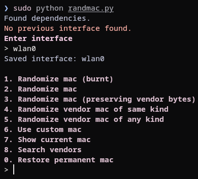

# randmac
Macchanger wrapper

## Quick start
```sh
## Macchanger must be installed!
# 1. Pick your interface. It must be a physical adapter.
ip link

# 2. Once you have your interface ready, run:
sudo python randmac.py

# If you want to use a shebang:
# Assuming you have randmac.py downloaded.
sed -i '1i\#!/usr/bin/env python3' randmac.py
mv randmac.py randmac
chmod +x randmac
sudo ./randmac
```

## CLI


## Dependencies
Requires macchanger. \
The script wont work without macchanger.
